<h1 align="center">🍌 Nimion HQ</h1>

<p align="center">
  <b>A crew of Claude Code agents with a task board, in a small 3D office.</b><br>
  Give the boss a job. The crew plans it, splits it, does it and reports back.<br>
  When a nimion needs you, it raises a hand.
</p>

<p align="center">
  <a href="LICENSE.md"></a>
  
  
  
</p>

<p align="center">
  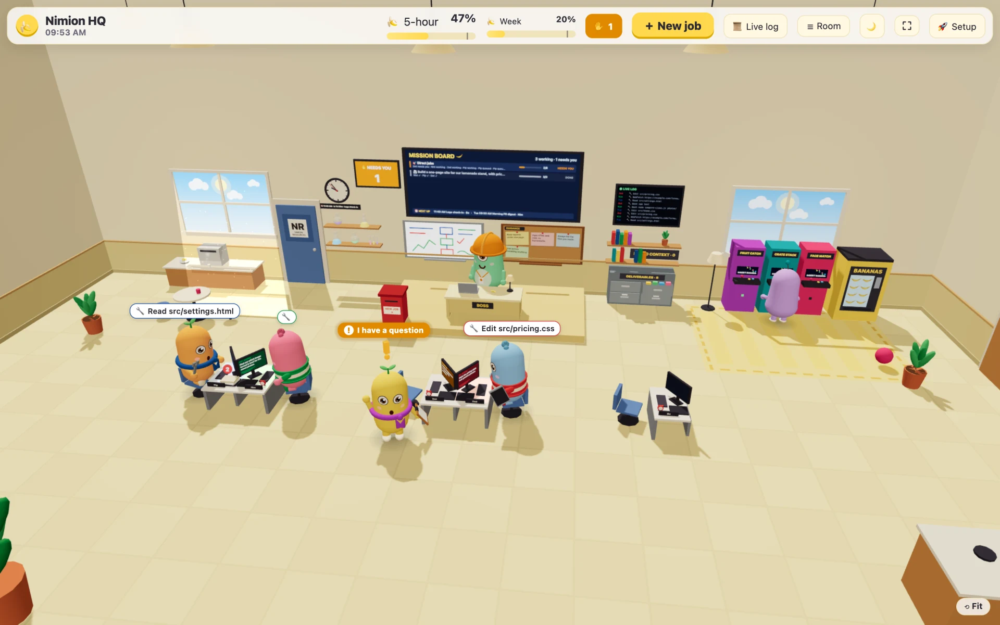
</p>

Every nimion is your own Claude Code, run headless (`claude -p`) on your claude.ai plan and its limits. There is no API key and nothing to `npm install`.

**Contents:** [What it is](#what-it-is) · [Why I built it](#why-i-built-it) · [Quick start](#quick-start) · [A tour](#a-tour) · [Meet the nimions](#meet-the-nimions) · [The fun bits](#the-fun-bits) · [The arcade](#the-arcade) · [Keyboard shortcuts](#keyboard-shortcuts) · [How it works](#how-it-works) · [Good to know](#good-to-know) · [Credits](#credits) · [Licence](#licence)

## What it is

- **A crew, not a chat.** Each nimion has a name, a role, and its own tools and skills. The sample crew is Tork the boss, Pip the engineer, Nim the researcher and Dot the reviewer. You can hire more.
- **A boss that plans.** Give Tork a goal. It writes a short plan, gives each step to the nimion that fits it, checks their reports, and writes you a final report that lists every file the crew made.
- **You stay in charge.** A tool call that needs a person waits for your **Allow** or **Deny**. A nimion that needs a decision asks one short question, with suggested answers.
- **An office you can read at a glance.** A working nimion types at its desk. A waiting one taps a foot. One that needs you stands up and waves. A finished job gets confetti.
- **Your plan, your machine.** It uses your claude.ai login (Pro, Max, Team or Enterprise) and stops starting runs before you reach your plan's limits. Your crew, jobs and files stay on your machine.
- **One folder.** It uses Node's built-in modules only, plus a bundled copy of three.js for the office.

## Why I built it

A personal, opinionated note.

For my own work I prefer the Claude desktop app, with sub-sessions, forks and the whole package. But "fork", "subagent", "persona", "skill" and "sub-session" are technical words. A tech-savvy person gets them. The non-techies around me and my younger cousins do not.

A room with a boss, a few helpers, a job box and a board on the wall is something everyone understands. And it is fun!

The arcade came in because this is AI: it works while you… just wait. So you might as well play. Play the ten games here, or go and play the really awesome NFSMWO, the fan-made port of NFS Most Wanted that runs in the browser on WASM. Holy hell, it's so exciting, and it has multiplayer 🔥

— Aishwary

## Quick start

You need:

- **Node 18 or later.**
- **Claude Code**, signed in with a Claude plan (Pro, Max, Team or Enterprise). Install it with `npm install -g @anthropic-ai/claude-code`, or see the [setup guide](https://docs.claude.com/en/docs/claude-code/setup).
- **A browser with WebGL 2.**

```bash
git clone https://github.com/aishwarydhare/Nimion-HQ.git
cd Nimion-HQ
claude auth login                 # once: pick your Claude.ai account, not an API key
./setup.sh                        # checks Node, Claude Code and your sign-in, and runs the self-tests
npm start -- ~/code/my-project    # the crew works in this folder (default: ./workspace)
```

Then open http://localhost:4321.

On macOS, `./setup.sh ~/code/my-project --service` keeps it running: it starts when you log in and restarts if it stops.

Everything else is in [the manual](docs/MANUAL.md).

## A tour

The page is the office, and every feature opens from something in the room. Hover anything to see its name.

<table>
<tr>
<td width="50%" valign="top">
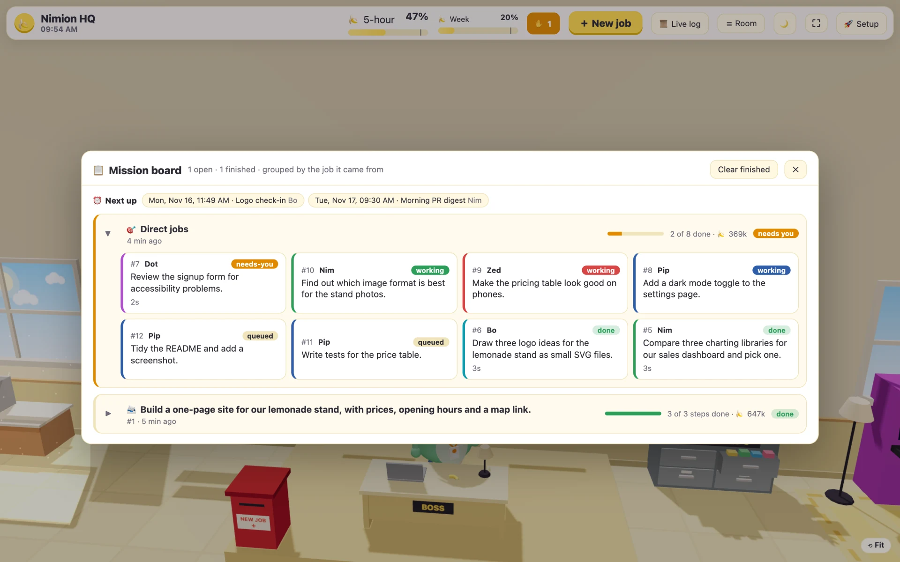
<br><b>📋 Mission board.</b> Every job, grouped by the goal it came from, with its state, its progress and what it used.
</td>
<td width="50%" valign="top">
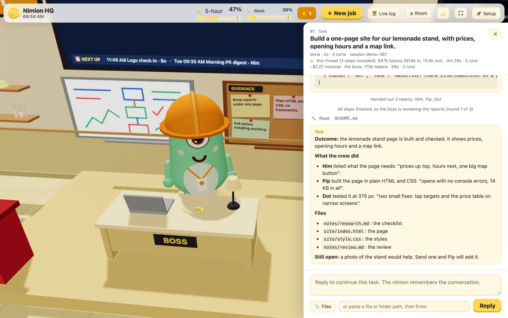
<br><b>🧢 The boss's final report.</b> The outcome, what each nimion did, every file the crew made, and what is still open.
</td>
</tr>
<tr>
<td valign="top">
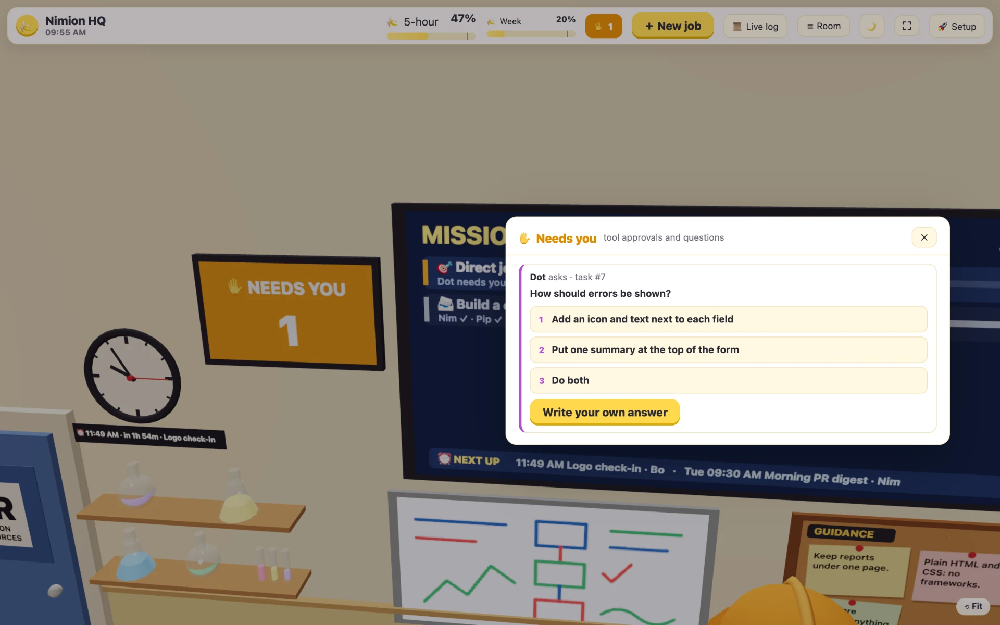
<br><b>✋ Needs you.</b> Tool approvals and questions wait here. The sign on the wall glows and counts them.
</td>
<td valign="top">
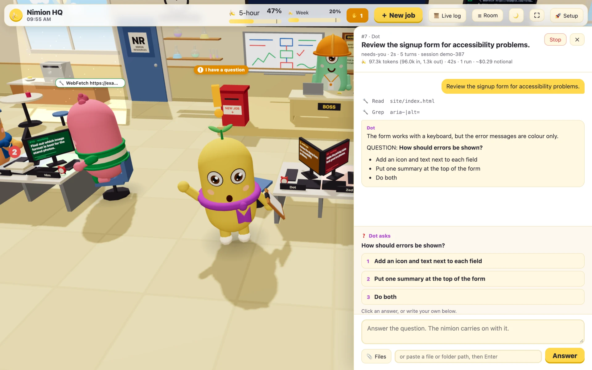
<br><b>💬 One-click answers.</b> A nimion that needs a decision asks one question. Click a suggestion, or write your own. The same session carries on.
</td>
</tr>
<tr>
<td valign="top">
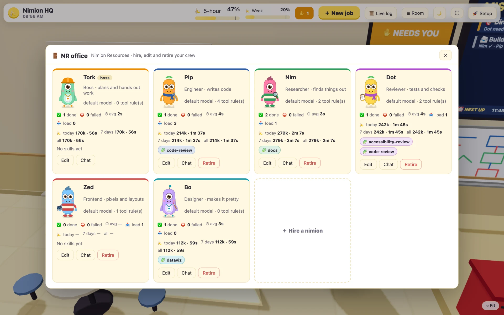
<br><b>🚪 NR office (Nimion Resources).</b> Hire, edit and retire nimions. Set each one's role, model, looks, skills and allowed tools.
</td>
<td valign="top">
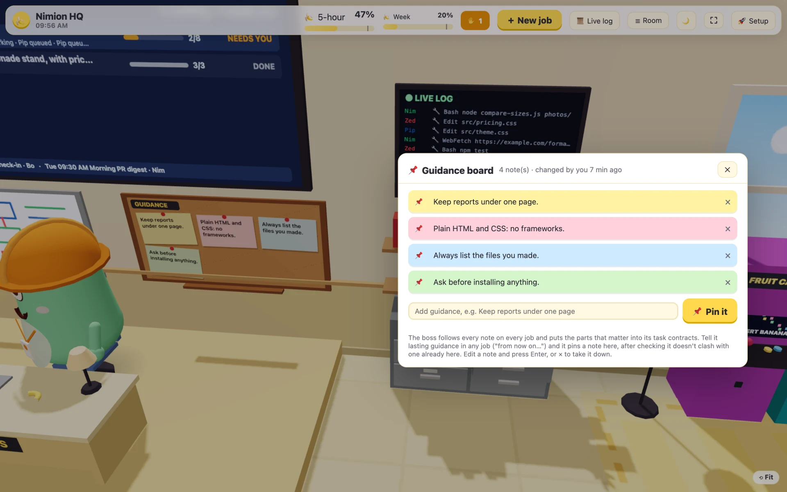
<br><b>📌 Guidance board.</b> Standing rules for the boss, one note each. Tell it "from now on…" in any chat and a note flies to the board.
</td>
</tr>
<tr>
<td valign="top">
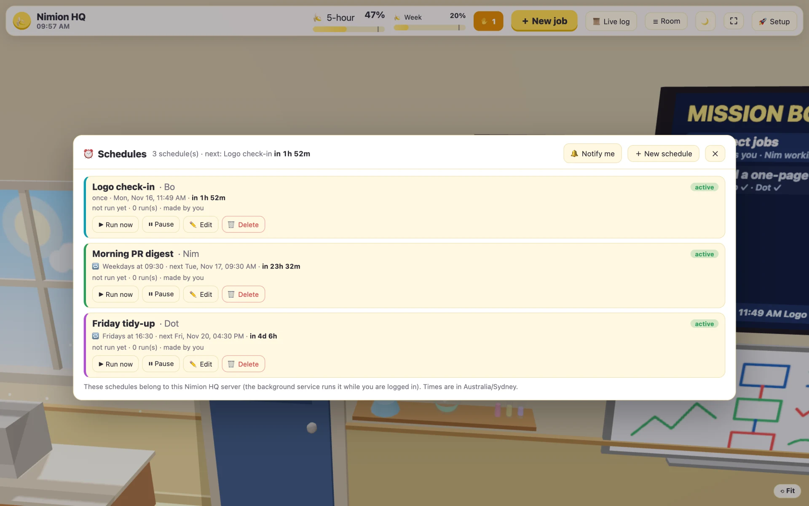
<br><b>⏰ Schedules.</b> Jobs that run later or on a repeat. Ask the boss ("every weekday at 9…") or use the popup.
</td>
<td valign="top">
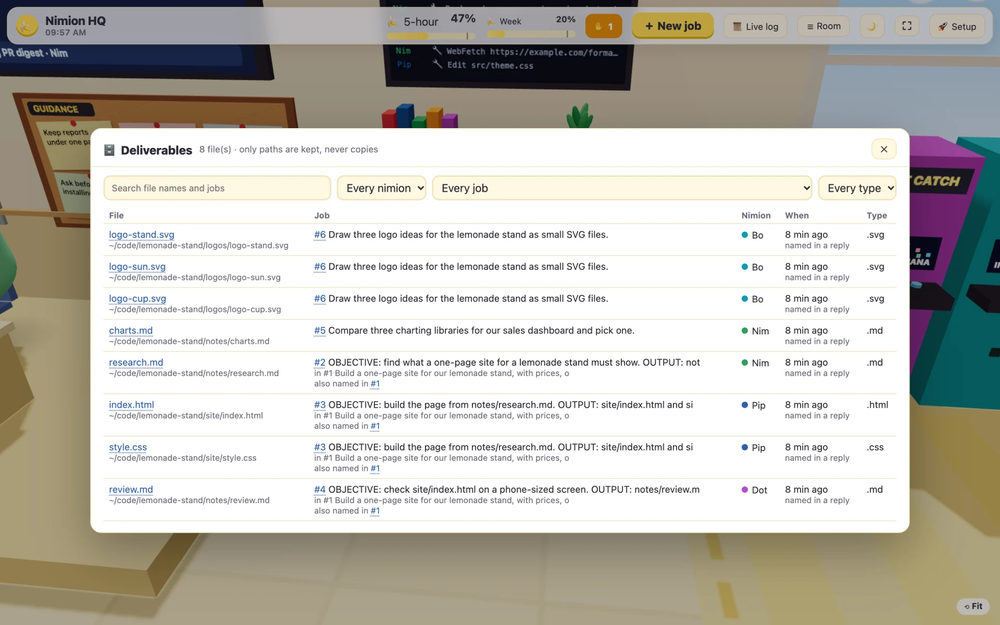
<br><b>🗄️ Deliverables.</b> Every file the crew made, one row each. Click a name to preview it.
</td>
</tr>
</table>

There is more in the room: a bookshelf for linked folders, a live log on the wall, a command palette, and a clock that follows your day.

<p align="center">
  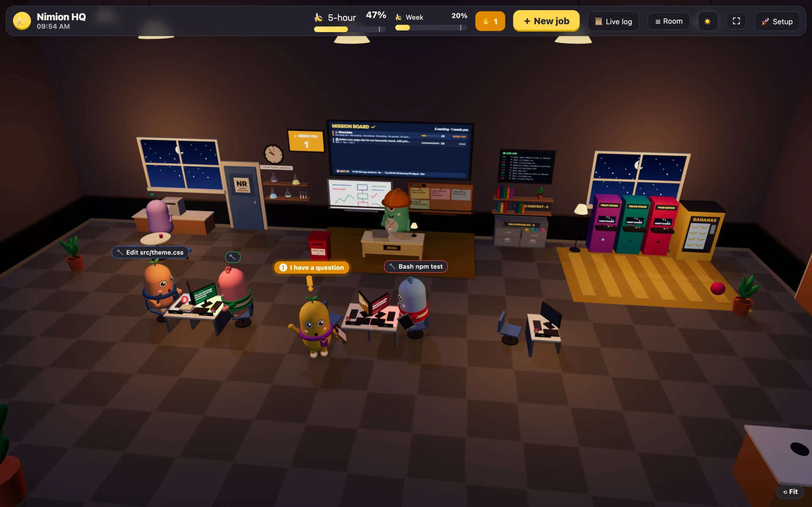
  <br><i>The office follows your local clock. This is night, in dark mode.</i>
</p>

## Meet the nimions

<p align="center">
  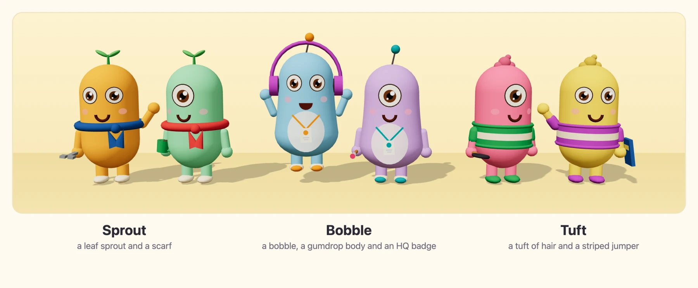
</p>

Every nimion is yours to dress. You pick:

- **A style:** Sprout, Bobble or Tuft.
- **A colour:** one of 12, from Banana to Cloud.
- **One eye or two.**
- **A prop:** one of 20, such as a hard hat, headphones, a wrench or a mug.

What a nimion wears (its scarf, its badge or its jumper) takes the nimion's own colour, the same one that marks its desk and its chat.

<p align="center">
  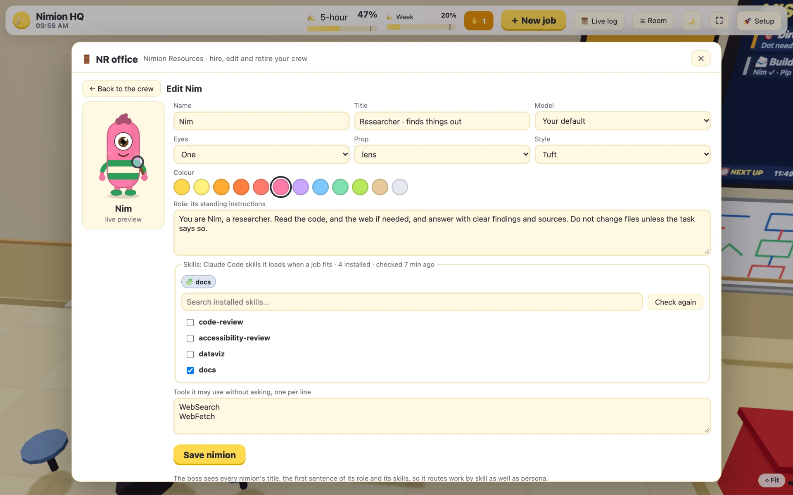
  <br><i>Hire or edit a nimion in the NR office. The preview changes as you choose.</i>
</p>

## The fun bits

The nimions do not sit still. What they do tells you what is going on.

<p align="center">
  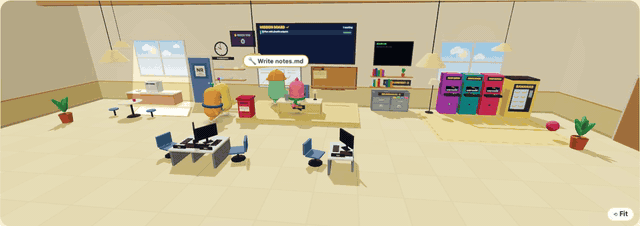
  <br><i>The boss plans at the whiteboard, then hands out the steps. Envelopes fly, and the crew gets to work.</i>
</p>

<p align="center">
  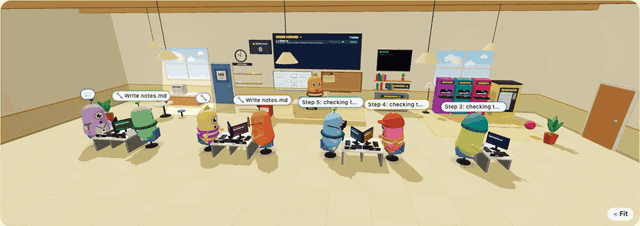
  <br><i>Job done: a jump, arms up, confetti, then the paper goes to the boss.</i>
</p>

<p align="center">
  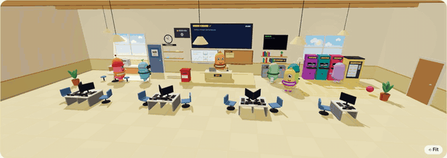
  <br><i>Nothing to do? They play catch and have a kick-about.</i>
</p>

| When a nimion is… | You see |
| --- | --- |
| **Idle** | It wanders, chats, gets a banana, juggles, or plays at the arcade. Two idle nimions play together: catch, a kick-about, tag, or a board game at the round table. |
| **Working** | It sits at its desk and types. The monitor shows the job, and a bubble shows the tool it is using right now. |
| **Queued up** | A pile of paper grows on the desk, one sheet per waiting job, and shrinks as the work gets done. |
| **Waiting on you** | It stands by the desk, waves, hops, and shows an orange "!". |
| **Waiting on another nimion** | It taps a foot. |
| **Paused by the usage limit** | It sleeps. |
| **Finished** | It jumps with its arms up in a burst of confetti, then carries the paper to the boss, who gives a 👍. |
| **Failed or stopped** | A facepalm, then a red paper to the boss, who answers 🤔. |
| **Handing off** | The boss walks the papers to a desk, or sends envelopes when it is busy. A nimion that finishes a step walks its papers to the next desk. |
| **Newly hired** | It walks in through the NR door. |

They react to you too. Win an arcade game and the idle nimions cheer. Lose, and they groan and shrug. Work always comes first: a nimion that gets a job stops playing at once.

## The arcade

The crew works while you wait, so there are ten small games in the corner. Idle nimions gather round the cabinets to watch.

<table>
<tr>
<td width="36%" valign="top" align="center">
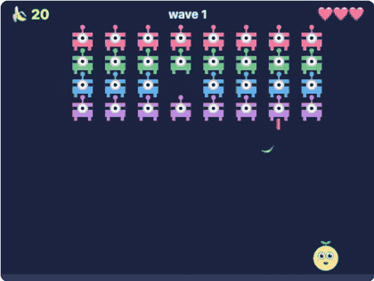
<br><i>Goggle-bot raid</i>
</td>
<td width="64%" valign="top" align="center">
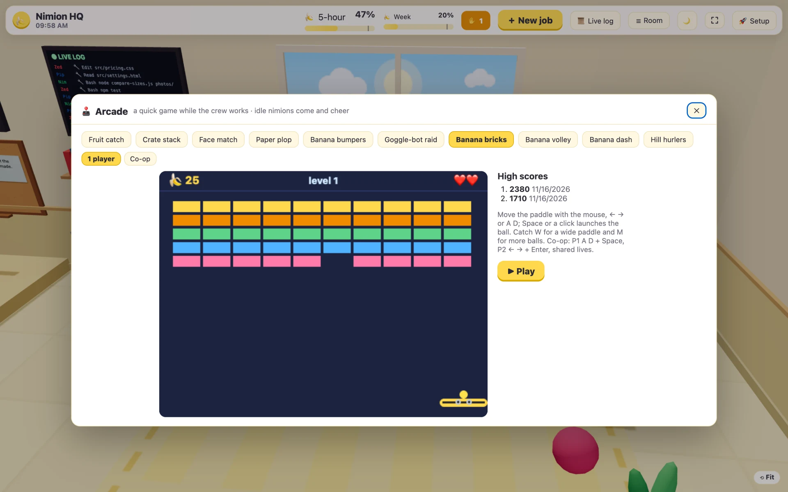
<br><i>Banana bricks, with the high scores beside it</i>
</td>
</tr>
</table>

| Game | Players | What it is |
| --- | --- | --- |
| Fruit catch | 1, co-op | Catch fruit and bananas, dodge the rotten ones |
| Crate stack | 1 | Drop sliding crates into a tower |
| Face match | 1, 2 (turns) | Find the pairs of nimion faces |
| Paper plop | 1, 2 (turns) | Throw a paper ball into a moving bin, with wind |
| Banana bumpers | 1, 2 (turns) | A pinball table with flippers, bumpers and banana targets |
| Goggle-bot raid | 1, co-op | A fixed shooter against marching goggle-bots |
| Banana bricks | 1, co-op | A brick breaker with wide-paddle and multi-ball power-ups |
| Banana volley | 1 vs CPU, 2 | Paddle tennis, first to 7 |
| Banana dash | 1, co-op, 2 | A top-down road race: dodge traffic, grab fuel |
| Hill hurlers | 2, 1 vs CPU | An artillery duel on hills, with wind and craters |

Two players share one keyboard: player 1 uses **W A S D + Space**, player 2 the **arrow keys + Enter**. The best five scores per game are kept.

## Keyboard shortcuts

Press **?** in the app to see this list. The keys rest while you type in a box and while the arcade is open, where the games use them.

| Key | Does |
| --- | --- |
| **N** | New job |
| **B** | The boss's chat (its latest job) |
| **[** and **]** | Previous and next nimion's chat |
| **Q** | Questions and approvals waiting for you |
| **J**, **G**, **M**, **A** | Mission board, guidance board, NR office, arcade |
| **S**, **O** | Schedules, deliverables |
| **L** | Live log |
| **F** | Full screen |
| **D** | Dark or light mode |
| **⌘ K** | Command palette: jump to any nimion, job, popup, schedule, game or action (Ctrl + K on Windows) |
| **⌘ Enter** | Send the job or reply (Ctrl + Enter on Windows) |
| **Esc** | Close the topmost thing |

<table>
<tr>
<td width="50%" valign="top">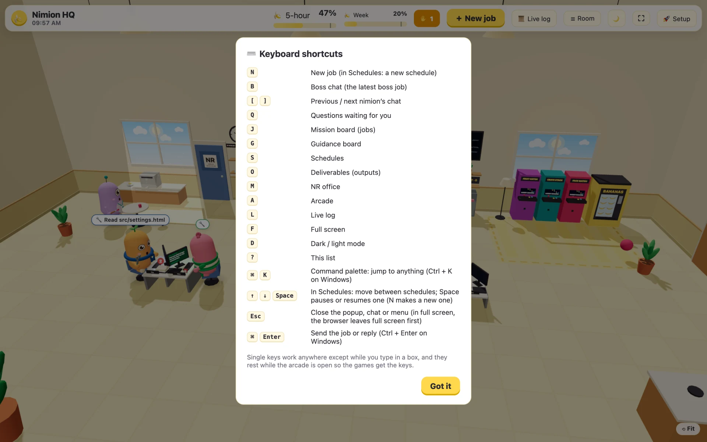</td>
<td width="50%" valign="top">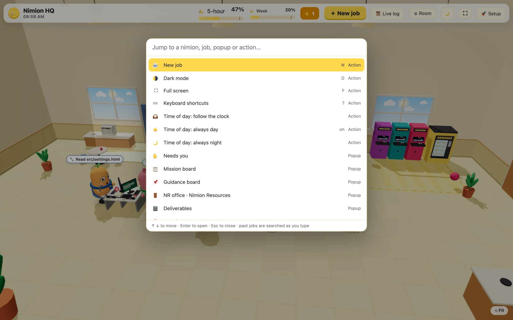</td>
</tr>
</table>

In the room itself: drag to look around, scroll or pinch to zoom, and double-click to see the whole room again.

## How it works

- **One run is one `claude -p`.** The server starts Claude Code headless with `--output-format stream-json` and reads the stream, so you see each tool call as it happens.
- **A clean environment.** API keys and a parent Claude session's `CLAUDE_*` variables are removed first. Runs use your plan's login, and sessions can be resumed.
- **Approvals from the page.** A small MCP server, `nimionhq`, receives Claude Code's permission prompts and holds each call until you click Allow or Deny.
- **The boss loop.** The boss's plan is a list of steps. Each step is a four-part contract: objective, output, tools, boundaries. Steps that will not touch the same files can run at the same time. When they finish, the boss is woken with the reports, for at most 3 rounds.
- **A git worktree per job.** In a git repo, each top-level job gets its own worktree and branch, so nimions never edit the same files and your checkout is never touched.
- **Brakes.** New runs stop starting at 90% of a plan window, and scheduled runs at 75%. A run that makes the same tool call 8 times in a row is stopped. If the plan would start using paid extra usage, every run stops.
- **Plain files.** Your crew is `crew.json` and your jobs are `data.json`. Both stay out of git.

The [manual](docs/MANUAL.md) covers the rest: tools and connectors, skills, linked folders, attachments, schedules, limits and every setting.

## Good to know

- **Allowed commands can run any code.** If you let a nimion use `python3` or `node` without asking, it can run anything. Keep each nimion's allowed tools short.
- **The server trusts local programs.** It accepts requests from this machine only and refuses other websites. But a nimion that is allowed to run `curl` could approve its own requests.
- **Each run has a start-up cost.** A run loads your normal Claude Code setup (plugins, hooks, MCP servers), which uses about 25k cached tokens before the nimion starts.
- **It depends on your plan's rules.** Runs draw from your subscription through `claude -p`. Anthropic can change how that is counted, so watch for policy changes.
- **The office needs WebGL 2.** There is no 2D version. Without it the page tells you what to change, and your jobs are not affected.
- **The background service is for macOS.** On Linux or Windows, run `npm start` in a terminal or under your own service manager.

## Credits

We read these projects to build this one, and they deserve the credit.

| Project | Licence | What we learned from it |
| --- | --- | --- |
| [Paperclip](https://github.com/paperclipai/paperclip) | MIT, © 2025 Paperclip AI | Results flow up: wake the boss with the reports when every step is done. Nudge a plan once if it has no task list. Give each task its own git worktree and never delete it, as both projects do. Studying how it handles approvals led us to Claude Code's permission-prompt hook. |
| [Munder Difflin](https://github.com/HarnessMD/munder-difflin) | MIT, © 2026 Chaitanya Giri | Clean the child's environment so sessions can resume. The four-part task contract. The rules for asking a human a question. Stop a run that repeats one call 8 times. An office where movement is the status: flying envelopes, and a cheer only after real work. |
| [three.js](https://github.com/mrdoob/three.js) | MIT, © 2010-2024 three.js authors | It draws the office. Version 0.170.0 is bundled unmodified in `vendor/three/`, with its licence. |
| [Claude Code](https://docs.claude.com/en/docs/claude-code/overview) | Anthropic | Every nimion is Claude Code. Nimion HQ is only the office around it. |

How we used them:

- We read both projects' public repositories and documentation on 5 Nov 2026. Nothing from them was run.
- Both are MIT-licensed, and both sites welcome automated readers in their `robots.txt`.
- We took ideas, not files. No source file, art or other asset from either project is in this repository.
- Our notes quote short excerpts, with file and line. Those stay under the MIT License.

The full study is in [RESEARCH.md](RESEARCH.md), with the long reports in [research/](research/). The copyright lines are in [NOTICE](NOTICE).

## Licence

Nimion HQ is **source-available, for noncommercial use**.

Copyright © 2026 Aishwary Dhare. It is licensed under the [PolyForm Noncommercial License 1.0.0](LICENSE.md).

In short:

- **You may** use it, study it, change it, build on it and share it, for any noncommercial purpose. Personal projects, hobby use, study and research count. So does use by charities, schools, public research bodies and government.
- **You may not** use it, or anything built on it, for a commercial purpose without a separate licence.
- **You must** pass on the licence terms and the `Required Notice` line in [NOTICE](NOTICE) with any copy you share, changed or not.

That is a summary. [LICENSE.md](LICENSE.md) is the licence.

- **For a commercial licence,** [open an issue](https://github.com/aishwarydhare/Nimion-HQ/issues) or reach me through [my GitHub profile](https://github.com/aishwarydhare).
- **Contributions** are welcome under the contributor licence grant in [CONTRIBUTING.md](CONTRIBUTING.md). It keeps the project under one owner.
- **Copyright information for every file** is in [REUSE.toml](REUSE.toml), so no source file carries a header.
- **The bundled three.js** in `vendor/three/` stays under the MIT License.

## Disclaimers

- Nimion HQ is an independent, unofficial project. It is not affiliated with, endorsed by or sponsored by Anthropic. "Claude" and "Claude Code" are trademarks of Anthropic.
- The nimions are original characters, drawn in code from simple shapes.
- NFSMWO is an unofficial fan project. It has nothing to do with Nimion HQ or with Electronic Arts.
- The screenshots show a staged demo: a sample crew and scripted runs, with no real model calls.
